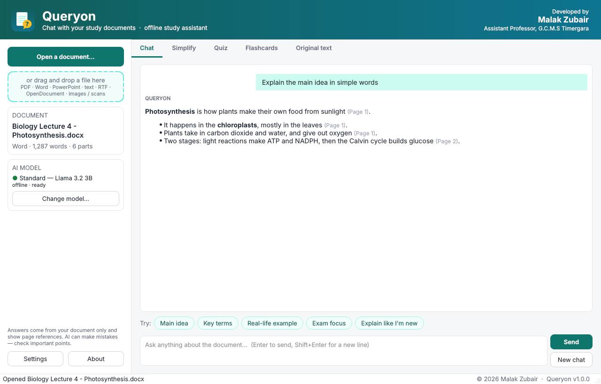
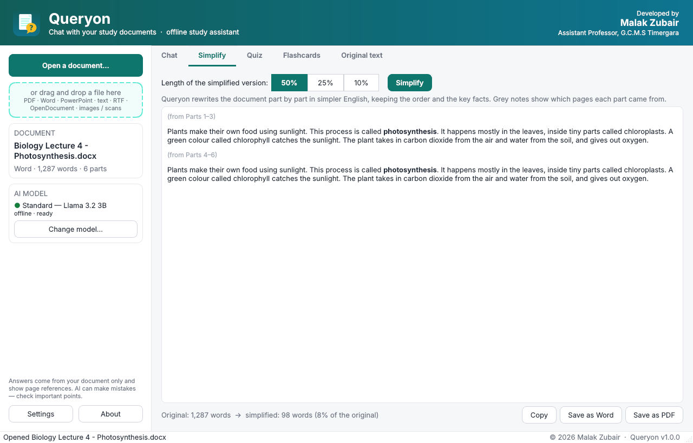
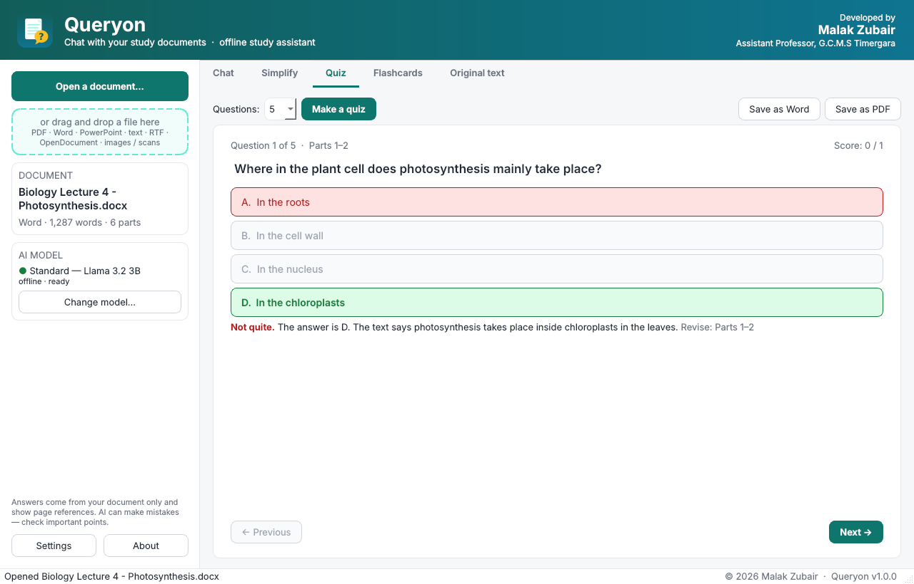
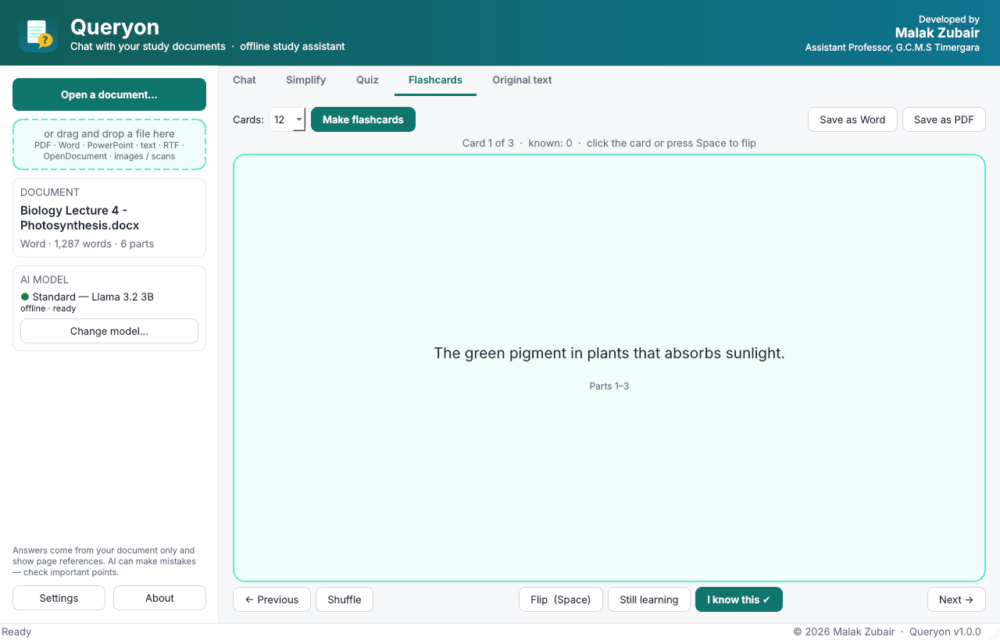

<p align="center"></p>

<h1 align="center">Queryon</h1>
<p align="center"><b>Chat with your study documents, get simpler versions, quizzes and flashcards — offline, on an ordinary Windows PC.</b></p>
<p align="center">Developed by <b>Malak Zubair</b>, Assistant Professor, G.C.M.S Timergara</p>

---

Students are handed lecture notes, slides and chapters that are often dense, written in difficult English, and longer than they have time for. Queryon lets a student open such a file and:

| | |
|---|---|
| **Chat** | Ask questions in plain English. Answers come only from the document and point to the page or slide, e.g. *(Page 3)*, so the student can check them. |
| **Simplify** | Rewrite the document in simpler English at **50 %**, **25 %** or **10 %** of its length, part by part and in the original order, with notes showing which pages each part came from. |
| **Quiz** | Multiple-choice questions with an explanation for each answer and the page to revise. |
| **Flashcards** | Key terms and ideas on cards to flip, shuffle and mark as known. |
| **Export** | Save simplified versions, quizzes and flashcards as Word or PDF. |

Everything runs **on the student's own computer**. No internet is needed after a one-time model download, no account, no API costs, and documents never leave the PC.



<details><summary>More screenshots</summary>





</details>

## Supported files

PDF · Word (.docx, and old .doc if Word or LibreOffice is installed) · PowerPoint (.pptx, including speaker notes; old .ppt likewise) · text · Markdown · RTF · OpenDocument (.odt, .odp) · **scanned PDFs and photos of pages** (.png, .jpg, …) through built-in OCR.

Documents can be up to **4,500 words (about 8 pages)**. Longer files can be cut to the first 4,500 words. The limit keeps the whole document in the model's memory at once, which makes answers better and lets Queryon run on 4–8 GB laptops.

## Install (Windows 10/11, 64-bit)

1. Download **Queryon-Setup-x.y.z.exe** from [Releases](../../releases) (or from the latest successful run under [Actions](../../actions), artifact *Queryon-Windows*).
2. Run it. No administrator rights are needed.
3. On first start, Queryon checks the PC's RAM and offers the right offline model to download once:

| Model | Download | For | Notes |
|---|---|---|---|
| Light — Qwen2.5 1.5B | 1.0 GB | 4–6 GB RAM | Fast, simpler output |
| **Standard — Llama 3.2 3B** | 2.0 GB | 8 GB+ RAM | Recommended |
| Better — Qwen2.5 7B | 4.7 GB | 16 GB+ RAM | Best quality, about 2× slower |

**Computer labs:** download the model once, then copy the `.gguf` file into the `models` folder inside Queryon's install folder on each PC (default `%LOCALAPPDATA%\Programs\Queryon\models`). No internet is needed on those PCs.

**Older PCs:** the installer includes two builds of the AI engine and picks one automatically: a fast one for processors with AVX2 (most PCs since about 2014) and a compatible one for older or budget CPUs, such as many Celeron and Pentium laptops.

### Optional: cloud mode
In **Settings**, Queryon can instead use an OpenAI-compatible API (Google Gemini, OpenAI, Groq, or a local Ollama/llama.cpp server). The student supplies their own key. This gives better quality on weak PCs but needs internet, and the document text is sent to that service.

## What to expect (CPU only, 8-page document)

| Task | Standard model, typical laptop |
|---|---|
| Opening the model | 5–20 s |
| Chat answer | starts in a few seconds |
| 10 % / 25 % / 50 % version | ~1 / 2–3 / 4–6 min, shown as it is written |
| Quiz (10 questions) | ~1–3 min |

Results are saved, so reopening the same document shows earlier summaries, quizzes and cards instantly.

**Limitations.** Small offline models can make mistakes, miss nuance, or produce a simplified version a little longer or shorter than the target; the actual percentage is always shown. Answers carry page references so they can be checked. English only. OCR works well on clear printed text, poorly on blurry photos, and not on handwriting.

## How it works

```
file ──► extract.py (PyMuPDF, python-docx, python-pptx, odfpy, striprtf, Tesseract OCR)
           └─► Document = blocks labelled "Page 3" / "Slide 5" / "Part 2"
                  └─► engine.py
                        chat        whole document in context + recent turns, answers cite labels
                        simplify    ~550–1600-word chunks rewritten to ratio × length, in order
                        quiz/cards  per-chunk generation, output forced to valid JSON by a
                                    llama.cpp grammar; options shuffled; duplicates topped up
                  └─► llm.py: llama.cpp (offline, GGUF) or any OpenAI-compatible API
UI: PySide6 (Qt) · packaging: PyInstaller + Inno Setup via GitHub Actions
```

## Run from source

```bash
pip install -r requirements.txt     # Windows also needs Tesseract for OCR
python run_queryon.py
```

Tests: `python -m pytest tests` (the llama.cpp tests build a tiny random model on the fly, so no download is needed). `python scripts/ui_smoke.py out/` drives the real window headlessly and saves screenshots. `python scripts/real_model_test.py light` downloads the light model and writes a report of real chat, simplified-version, quiz and flashcard output. The GitHub workflow runs all three and builds the installer.

## Licence

Code: MIT © 2026 Malak Zubair. Models are downloaded separately under their own licences: Qwen2.5 (Apache 2.0) and Llama 3.2 (Llama 3.2 Community License, Built with Llama). Tesseract OCR: Apache 2.0.
